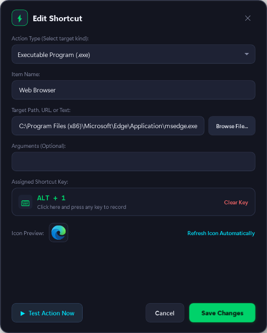

# Insight Hot Key ⚡
> Fast, elegant, and lightweight hotkey launcher for Windows 10 and 11.  
> برنامج إدارة وتشغيل الاختصارات السريعة فائق السرعة والأناقة لنظام ويندوز.

---

## 🌟 Highlights / أبرز الميزات

- ⚡ **Global Instant Dashboard**: Summon the launcher anytime from anywhere using `ALT + Space`.
- 🔄 **Smart Window Switching**: Automatically brings already-running applications to the foreground instead of launching duplicates.
- 🛡️ **Core Windows Shortcut Protection**: Protects essential system shortcuts (`Ctrl+C`, `Ctrl+V`, `Ctrl+S`, `Alt+F4`, etc.) from accidental overrides, with optional toggle and safety warnings.
- 🌐 **100% Bilingual Interface**: Pure Arabic (`العربية`) and pure English (`English`) with zero mixed words or untranslated labels.
- 📊 **Dynamic Slot Rows**: Unlimited shortcut rows with smooth scrolling; automatically expands when slots are full.
- 📁 **Multi-Type Support**: Organize Applications (`.exe`), Folders, Website URLs, Text Snippets, and System Commands with distinct glowing pill badges.
- 🖱️ **Drag & Drop**: Simply drag any application or folder from your desktop into the window to assign it immediately.
- 💾 **100% Portable & Offline**: Saves configuration locally in `config.json` with zero telemetry and zero registry bloat.

---

## 📸 Screenshots / لقطات الشاشة

### Main Dashboard (English & Arabic)
| English Interface | الواجهة العربية |
| :---: | :---: |
|  |  |

### Settings & Configuration
| English Settings | إعدادات البرنامج بالعربية |
| :---: | :---: |
|  |  |

### Shortcut Editor Dialog
| Edit Item (English) | تعديل الاختصار (عربي) |
| :---: | :---: |
|  |  |

---

## 🚀 Download & Installation / التحميل والتثبيت

You can find the latest release binaries inside the `output/` folder:

1. **Portable Version (`InsightHotKey_v1.0.0_Portable.zip`)**:
   - Extract anywhere (e.g. USB flash drive or `PortableApps`).
   - Run `InsightHotKey.exe`. No installation required.
2. **Setup Installer (`InsightHotKey_Setup_v1.0.0_x64.exe`)**:
   - Standard 64-bit Windows installer created with Inno Setup.
   - Includes Start Menu shortcuts, optional Desktop shortcut, and uninstaller.

### Verification (SHA-256 Checksums)
All release packages include a `SHA256SUMS.txt` file in `output/` for security verification.

---

## ⌨️ Default Shortcuts / الاختصارات الافتراضية

| Hotkey | Action (English) | الإجراء (بالعربية) |
| :--- | :--- | :--- |
| `ALT + Space` | Toggle Dashboard visibility | إظهار / إخفاء اللوحة السريعة |
| `ALT + 1` | Web Browser | متصفح الإنترنت |
| `ALT + 2` | This PC (File Explorer) | جهاز الكمبيوتر |
| `ALT + 3` | Downloads Folder | مجلد التنزيلات |
| `ALT + 4` | Documents Folder | مجلد المستندات |
| `ALT + 5` | Notepad | المفكرة |
| `ALT + 6` | Calculator | الحاسبة |
| `ALT + T` | Task Manager | مدير المهام |
| `ALT + L` | Lock Screen | قفل الشاشة |

---

## 🛠️ Build from Source / البناء من المصدر

### Requirements:
- Windows 10 or 11 (x64)
- [.NET 8.0 SDK](https://dotnet.microsoft.com/download/dotnet/8.0)
- Inno Setup 6 (optional, for compiling the setup installer)

### Build Commands:
```powershell
# 1. Clone repository
git clone https://github.com/insight-software/insight-hot-key.git
cd insight-hot-key

# 2. Build Release binary
dotnet build -c Release InsightHotKey.csproj

# 3. Compile Inno Setup installer (optional)
iscc "Insight Hot Key.iss"
```

---

## 📄 License / الترخيص

Copyright (c) 2026 INSIGHT Software. All rights reserved.  
Distributed under the terms described in the included `LICENSE.txt` file.
