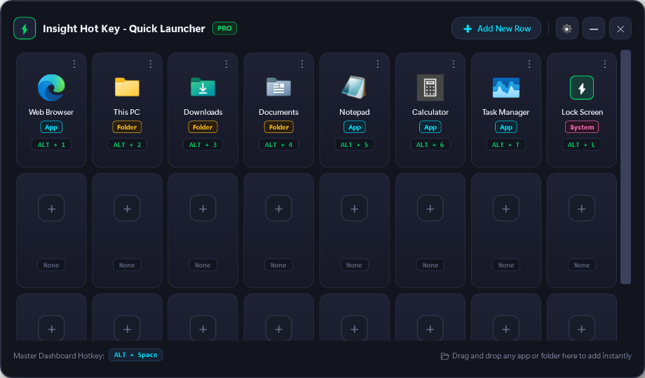
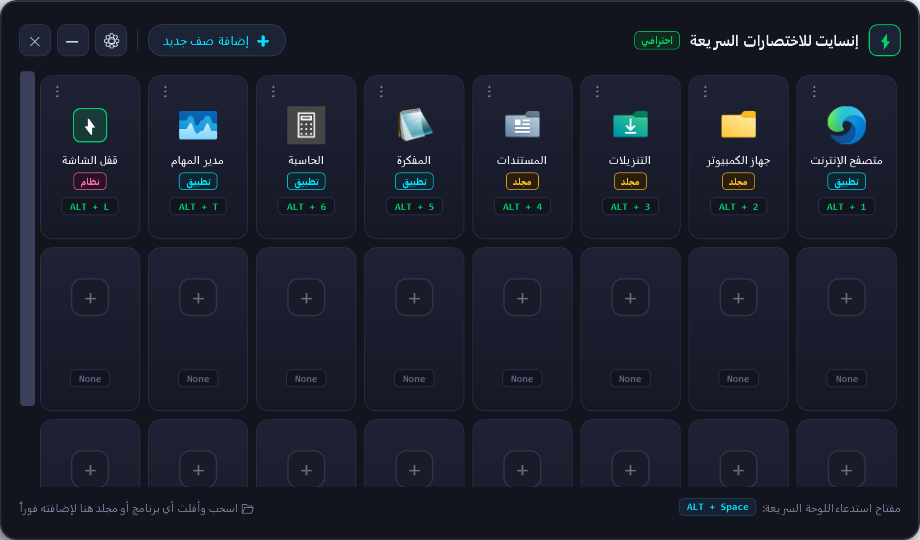
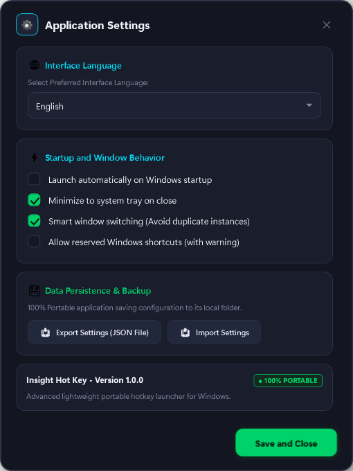
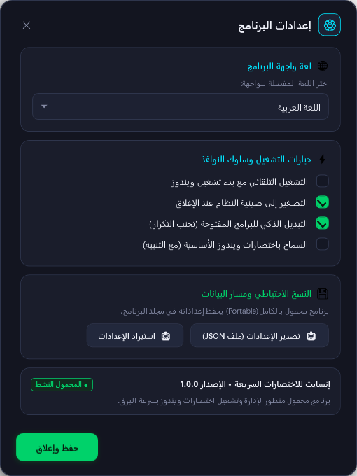
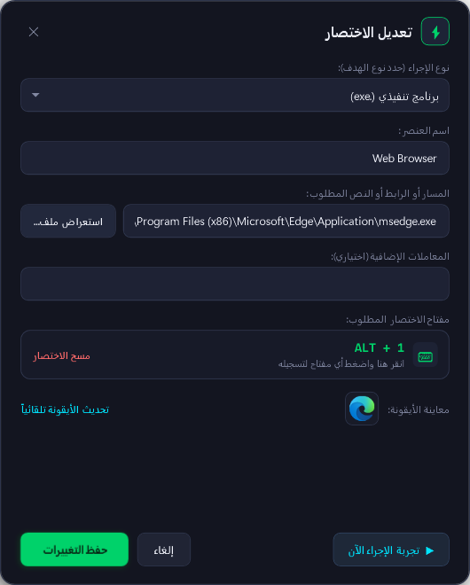

# Insight Hot Key ⚡
> Fast, elegant, and lightweight hotkey launcher for Windows 10 and 11.  
> برنامج إدارة وتشغيل الاختصارات السريعة فائق السرعة والأناقة لنظام ويندوز.

---

## ⭐ Support & Rate Us / ادعمنا بالتقييم

> **⭐ Loving Insight Hot Key? Please give it a 5-Star rating on GitHub!**  
> If you find this launcher fast, helpful, and productive, please click the **Star ⭐** button at the top right of this repository to show your support!
> 
> **⭐ إذا أعجبك البرنامج، نرجو منك دعمه بالتقييم بـ 5 نجوم!**  
> إذا نال البرنامج والواجهة العربية الفاخرة إعجابك، يسعدنا جداً دعمك للمشروع بالضغط على زر **Star ⭐** في أعلى يمين الصفحة لدعم استمرار التطوير المجاني.

---

## 🌟 Highlights / أبرز الميزات

- ⚡ **Global Instant Dashboard**: Summon the launcher anytime from anywhere using `ALT + Space`.
- 🔄 **Smart Window Switching**: Automatically brings already-running applications to the foreground instead of launching duplicates.
- 🛡️ **Core Windows Shortcut Protection**: Protects essential system shortcuts (`Ctrl+C`, `Ctrl+V`, `Ctrl+S`, `Alt+F4`, etc.) from accidental overrides, with optional toggle and safety warnings.
- 🌐 **100% Bilingual Interface**: Pure Arabic (`العربية`) and pure English (`English`) with zero mixed words or untranslated labels.
- 📊 **Dynamic Slot Rows**: Unlimited shortcut rows with smooth scrolling; automatically expands when slots are full.
- 📁 **Multi-Type Support**: Organize Applications (`.exe`), Folders, Website URLs, Text Snippets, and System Commands with distinct glowing pill badges.
- 🖱️ **Drag & Drop**: Simply drag any application or folder from your desktop into the window to assign it immediately.
- 💾 **100% Portable & Offline**: Saves configuration locally in `config.json` with zero telemetry and zero registry bloat.

---

## 📸 Screenshots / لقطات الشاشة

### Main Dashboard (English & Arabic)
| English Interface | الواجهة العربية |
| :---: | :---: |
|  |  |

### Settings & Configuration
| English Settings | إعدادات البرنامج بالعربية |
| :---: | :---: |
|  |  |

### Shortcut Editor Dialog
| Edit Item (English) | تعديل الاختصار (عربي) |
| :---: | :---: |
|  |  |

---

## 🚀 Download & Installation / التحميل والتثبيت

Both the official installer and portable versions are available directly in this repository:

1. **Setup Installer**:
   - 📦 [InsightHotKey_Setup_v1.0.0_x64.exe](InsightHotKey_Setup_v1.0.0_x64.exe)
   - Standard 64-bit Windows installer with Start Menu shortcuts and optional Desktop shortcut.

2. **Portable Version**:
   - 💼 [InsightHotKey_v1.0.0_Portable.zip](InsightHotKey_v1.0.0_Portable.zip)
   - Extract anywhere (e.g. USB flash drive or `PortableApps`) and run directly. Zero installation needed.

### Verification (SHA-256 Checksums)
Refer to [SHA256SUMS.txt](SHA256SUMS.txt) for cryptographic checksums of all release packages.

---

## ⌨️ Default Shortcuts / الاختصارات الافتراضية

| Hotkey | Action (English) | الإجراء (بالعربية) |
| :--- | :--- | :--- |
| `ALT + Space` | Toggle Dashboard visibility | إظهار / إخفاء اللوحة السريعة |
| `ALT + 1` | Web Browser | متصفح الإنترنت |
| `ALT + 2` | This PC (File Explorer) | جهاز الكمبيوتر |
| `ALT + 3` | Downloads Folder | مجلد التنزيلات |
| `ALT + 4` | Documents Folder | مجلد المستندات |
| `ALT + 5` | Notepad | المفكرة |
| `ALT + 6` | Calculator | الحاسبة |
| `ALT + T` | Task Manager | مدير المهام |
| `ALT + L` | Lock Screen | قفل الشاشة |

---

## 💻 System Requirements / متطلبات التشغيل

- **Operating System**: Windows 11 / Windows 10 (64-bit)
- **Architecture**: x64
- **Runtime**: Self-contained (no external dependencies needed)
- **Memory**: Less than 20 MB RAM

---

## 📄 License / الترخيص

Copyright (c) 2026 INSIGHT Software. All rights reserved.  
Distributed under the terms described in the included `LICENSE` file.
